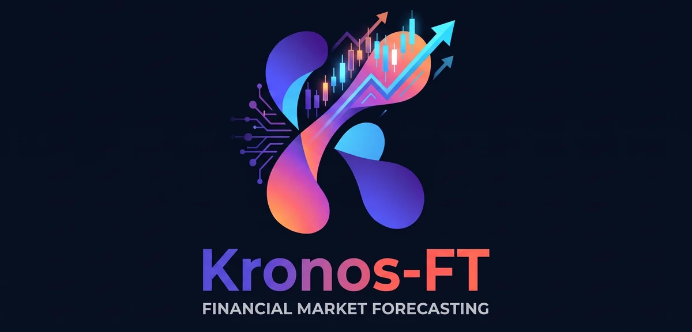

<p align="center">
  
</p>

# Kronos-FT for NASDAQ, NSE, TSE, & IDX

---

Fine-tuning the quantitative foundation model **Kronos** (Shi, et al., *A Foundation Model for the Language of Financial Markets*, Tsinghua University, AAAI 2026) tailored specifically across equity markets:

1. **IDX** (Indonesia Stock Exchange) 🇮🇩 - *Ready*
2. **NASDAQ** (United States) 🇺🇸 - *on-going*
3. **TSE** (Tokyo Stock Exchange, Japan) 🇯🇵 - *on-going*
4. **NSE** (National Stock Exchange of India) 🇮🇳 - *phase 1-reject*

---

## 🌟 Key Features & Architecture Specifications

- **Timeframe-Agnostic:** The model is trained in a unified manner across 8 timeframes simultaneously:
  - `1T` (1-minute)
  - `3T` (3-minute)
  - `5T` (5-minute)
  - `15T` (15-minute)
  - `30T` (30-minute)
  - `1H` (1-hour)
  - `D` (Daily)
  - `W` (Weekly)
- **Zero-Lookahead Temporal Splitting:** Dataset partitioning strictly enforces chronological ordering with temporal gap guards to prevent future lookahead leakage.
- **Dual-Model Hub Loading:** Supports flexible loading from either the [Hugging Face Hub](https://huggingface.co/andreiramani/kronos-ft) (under per-market subfolders, e.g., `idx/`) or local directories.

---

## 🚀 Quickstart & Model Inference

Model weights and tokenizers are hosted at [**andreiramani/kronos-ft**](https://huggingface.co/andreiramani/kronos-ft). You can load them via multiple flexible options (example below for the IDX market):

### 1. Fast One-Line Loading (Recommended)
```python
from model import KronosPredictor

# Mode A: Flat Directory Mode (auto-detects models/{exchange}_model.safetensors & models/{exchange}_tokenizer.safetensors)
predictor = KronosPredictor.from_pretrained("models", exchange="idx", device="cuda:0")

# Mode B: Explicit Safetensors File Paths (predictor weights first, tokenizer weights second)
predictor = KronosPredictor.from_pretrained(
    "models/idx_model.safetensors",
    "models/idx_tokenizer.safetensors",
    device="cuda:0"
)

# Mode C: Directly from the Hugging Face Hub (auto-resolves subfolder="idx"):
predictor = KronosPredictor.from_pretrained("andreiramani/kronos-ft", exchange="idx", device="cuda:0")
```

### 2. Manual / Granular Loading
```python
from model import KronosTokenizer, Kronos, KronosPredictor

# Directly from .safetensors files in the 'models/' directory
tokenizer = KronosTokenizer.from_pretrained("models/idx_tokenizer.safetensors")
model = Kronos.from_pretrained("models/idx_model.safetensors")

# (Alternative for Option A: load from 'models/' folder using filename_prefix)
# tokenizer = KronosTokenizer.from_pretrained("models", filename_prefix="idx_tokenizer")
# model = Kronos.from_pretrained("models", filename_prefix="idx_model")

# Initialize inference predictor engine
predictor = KronosPredictor(model, tokenizer, device="cuda:0", max_context=512)
```

---

## 🛠️ Environment Requirements

Key dependencies:
- `torch>=2.0.0` (with CUDA acceleration)
- `einops>=0.8.0`
- `safetensors>=0.4.0`
- `pandas>=2.0.0`, `numpy>=1.24.0`
- `pyyaml`, `tqdm`, `matplotlib`

---

## 📊 Dataset Coverage

Kronos-FT was trained on a massive multi-resolution dataset comprising **48,294,489 K-line candlestick bars** across **4 global stock exchanges** (**IDX**, **NASDAQ**, **TSE**, and **NSE**) covering **7 timeframes** (`1T`, `5T`, `15T`, `30T`, `1H`, `D`, `W`):

* 🇮🇩 **IDX (Indonesia):** 9.65M bars (50 liquid constituents across 11 IDX-IC sectors, 10+ years of historical data).
* 🇺🇸 **NASDAQ (US):** 10.45M bars (30 mega-cap tech equities, 25+ years of daily data since 2000).
* 🇯🇵 **TSE (Japan):** 6.68M bars (30 Nikkei 225 constituents, Tokyo trading session market structure).
* 🇮🇳 **NSE (India):** 21.49M bars (30 Nifty 50 equities, 7.5+ years of verified intraday depth).

> 📖 **Comprehensive Dataset Documentation:**  
> Detailed tables covering date ranges, calendar durations, bar counts per timeframe, and microstructure characteristics are available in [**`DATASET.md`**](docs/DATASET.md).

---

## 👤 Developer & Fine-Tuner
- **Lead / Fine-Tuner:** [Andrei Ramani](https://www.linkedin.com/in/andreiramani/)

---

## ⚖️ Disclaimer

> [!WARNING]
> **NOT FINANCIAL OR INVESTMENT ADVICE:**  
> All model outputs, price trajectories, candlestick forecasts, quantitative metrics, and evaluations produced by **Kronos-FT** are provided strictly for academic research, artificial intelligence experimentation, and financial time-series modeling studies. **None of the data, projections, or insights generated constitute formal financial advice, investment recommendations, endorsements, or legal solicitation to buy or sell securities.**  
>
> Trading financial instruments across equities markets (including IDX, NASDAQ, TSE, and NSE) involves substantial volatility and high risk of capital loss. Historical backtesting and past performance do not guarantee future results or profitability.  
>
> Users bear sole and full responsibility for all trading decisions, independent analysis (*Do Your Own Research* / DYOR), and risk management execution. The developers and contributors assume no liability whatsoever for any direct or indirect financial losses, damages, or costs incurred as a result of using this software or these models.

---

## 📜 License & Attribution
Base model, original work, and paper:
*Shi et al., "Kronos: A Foundation Model for the Language of Financial Markets", AAAI 2026 / arXiv:2508.02739.*  
Adapted for quantitative financial multi-exchange ecosystems (IDX, NASDAQ, TSE, NSE).

